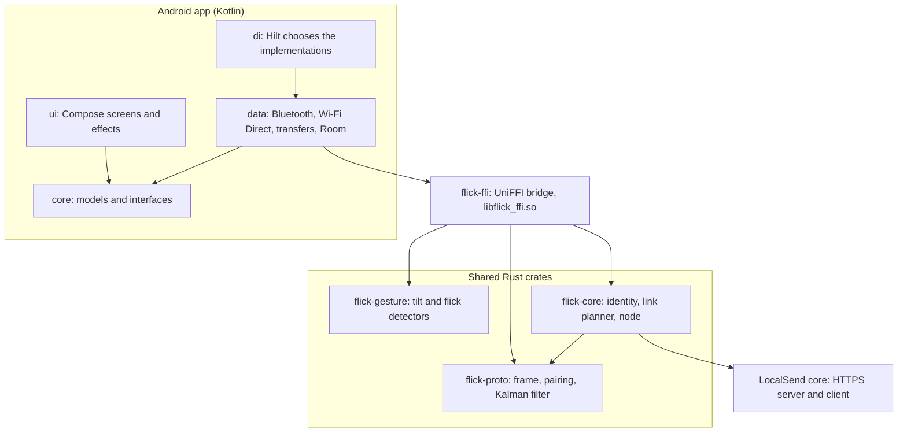
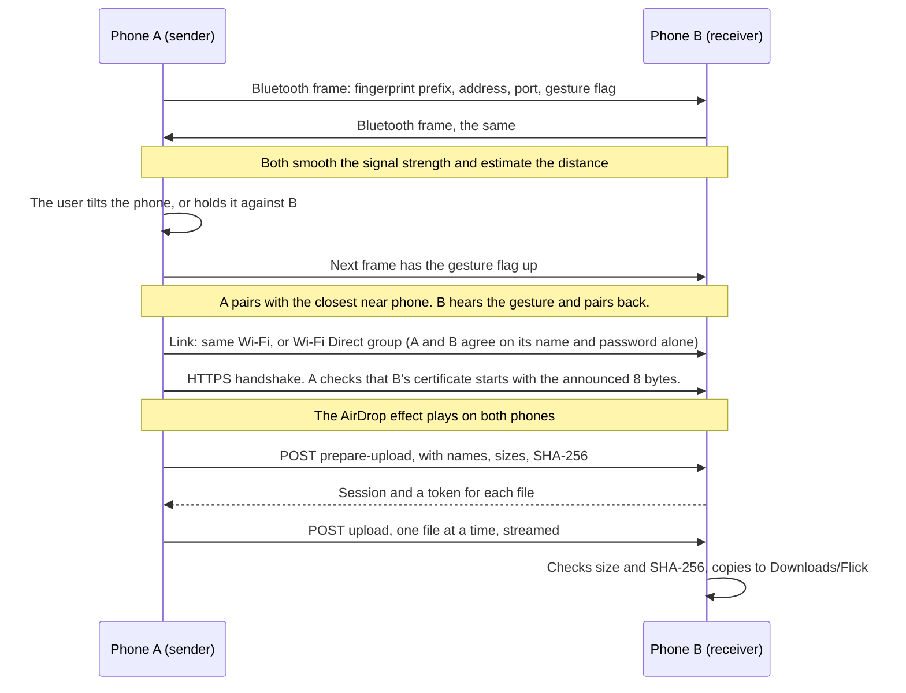
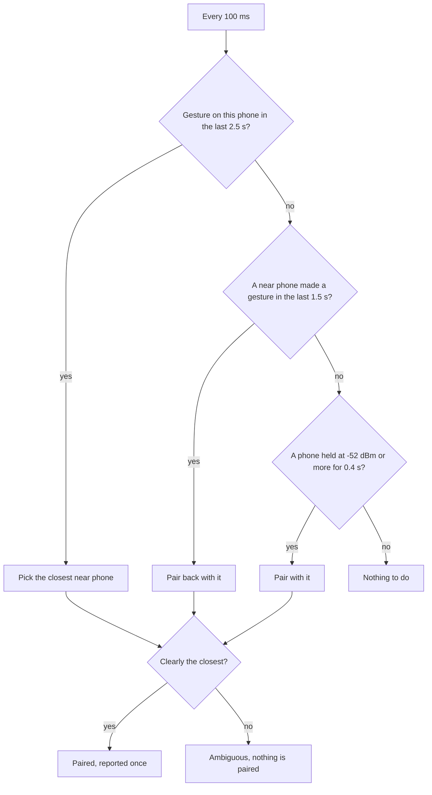
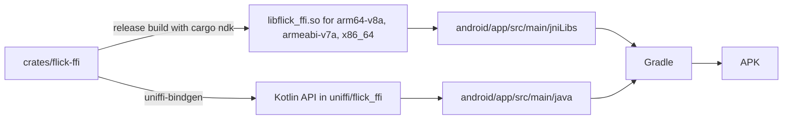

# Architecture

This document explains how Flick works, from the radio to the pixels. The README gives the overview and the build steps.

## The big picture



The Rust crates contain no platform code. They do the protocol, the sensor maths, the pairing decision and the
transfer. The Android app does what only Android can: Bluetooth radio access, Wi-Fi Direct, sensors, files and screens.

## The flow of one transfer



Bluetooth carries no secret and no file data. It only says who is near and how close.

## The Bluetooth frame

Each phone advertises one legacy advertisement with manufacturer data (id `0xFFFF`, the value reserved for tests and internal
use). The build fails if the frame ever grows past the 31 bytes a legacy advertisement allows (`flick-proto/src/ble.rs`).

| Bytes | Field | Meaning |
| --- | --- | --- |
| 0 | magic | `0xF1`. A scan filter on this byte hides every other device's data |
| 1 to 8 | fingerprint prefix | First 8 bytes of the SHA-256 of the phone's TLS certificate |
| 9 to 12 | IPv4 address | Where the phone can be reached on its network, or its Wi-Fi Direct address |
| 13 to 14 | port | Port of the phone's HTTPS server |
| 15 to 18 | nonce | Random bytes, chosen when discovery starts |
| 19 | flags | Bit 0 is up for 2.5 seconds after a gesture |
| 20 | gesture counter | Grows by one at each gesture, so a repeated gesture is told apart from one still showing |

Eight bytes of the fingerprint are sent because four bytes (32 bits) can be forged by trying certificates for a few seconds.
Sixty four bits cannot be forged in practice.

## Distance

Distance is estimated from the signal strength, RSSI, in dBm.

1. **Smoothing.** One reading jumps by about 4 dB. A one dimensional Kalman filter smooths the readings of each phone. It assumes the true value
   drifts by 0.5 dB squared between readings and that a reading has a noise of 16 dB squared.
2. **Path loss.** The log distance model turns the smoothed value into metres:

   ```
   distance = 10 ^ ((RSSI_at_1m - RSSI) / (10 * n))     with RSSI_at_1m = -59 dBm and n = 2.2
   ```

   `n` is how fast a signal fades: 2 in open air, more indoors.
3. **Proximity.** 1 when the phones touch and 0 at two metres or more. The screens use it to place a phone on the radar.

The result is an estimate, good enough to tell which phone is the closest, which is all pairing needs.

## Gestures

**Tilt** (`flick-gesture/src/tilt.rs`). The gyroscope reports how fast the phone turns around each axis, in radians per second.
Adding the readings over the last 600 milliseconds gives the angle turned: `angle = sum(speed * dt)`.
A gesture is reported when all of these hold:

| Condition | Value | Why |
| --- | --- | --- |
| Net angle on the main axis | at least 0.35 rad, about 20 degrees | A phone brought toward another one barely turns |
| Peak speed | at least 0.8 rad/s | Slow drifting is not a gesture |
| Other two axes | at most 80 percent of the main one | Tumbling is not a gesture |
| Time since the last tilt | at least 1 second | One gesture, one event |

Walking and shaking turn the phone back and forth, so the positive and negative turns cancel in the sum. A turn made during the cooldown is
forgotten, so it cannot fire the moment the cooldown ends.

**Flick** (`flick-gesture/src/lib.rs`). A short sharp push of the phone sends the file. A low pass filter with a weight of 0.9 estimates gravity,
and subtracting it leaves the acceleration of the hand. A flick is a burst above 14 m/s squared that settles within 250 ms.

**Contact.** Two phones held together give the strongest signal a phone can see. A signal of at least -52 dBm held for 0.4 seconds counts as a pairing
with no gesture. The phone must fall below -62 dBm before a contact can pair again, so phones lying side by side do not pair in a loop.

## Pairing

The pairing engine is a pure function of the frames it is given and the time it is told (`flick-proto/src/pairing.rs`). It has no clock and no
I/O, so its tests are exact.



| Rule | Value |
| --- | --- |
| A phone is near | smoothed signal of at least -65 dBm, about two metres |
| A phone is current | heard in the last 3 seconds |
| A phone that gestured | counts as closer by 6 dB |
| Clearly the closest | stronger than the second by at least 6 dB, about 1.6 times closer |

Pairing the wrong phone is worse than pairing none, so two phones about as close give an ambiguous answer and the screen asks the user to move nearer.

Both phones pair at about the same moment: the phone that was moved pairs at once, and the other pairs when it hears the gesture flag in the next frame.

## Reaching the other phone

`flick-core/src/link.rs` decides what this phone does about a phone it heard.

| Situation | Plan |
| --- | --- |
| The peer's address is on a network this phone is on | Use it. Nothing to set up |
| Otherwise, and this phone's fingerprint prefix is larger | Create a Wi-Fi Direct group |
| Otherwise | Join the group |

Both phones compute the same group without any message:

```
input    = "flick-link-v1" + lower_prefix + higher_prefix
digest   = SHA-256(input), in uppercase hex
ssid     = "DIRECT-FK-" + digest[0..8]
password = digest[8..24]
```

The password is not a secret: anyone who heard both frames can compute it. It does not need to be, because every transfer still has to pass the TLS certificate check.

Android side (`data/nearby/NearbyDiscovery.kt`, `data/nearby/WifiDirectLink.kt`):

- The closest phone is linked ahead of time, as soon as its signal is at least -75 dBm, about three metres. A Wi-Fi Direct group takes seconds to form, so it starts while the phones are still being brought together.
- Two phones can sit on different Wi-Fi networks that use the same addresses, for example two home routers that both give out 192.168.1.x. If the phone cannot be reached on a shared network after two tries, the phones meet in a Wi-Fi Direct group instead.
- The phone that joins asks again up to four times, because the other phone opens its group at about the same moment.

## The transfer

`flick-core/src/node.rs` runs the LocalSend protocol, version 2, over HTTPS.

**Identity.** At first start each phone creates a self signed TLS certificate. Its SHA-256 fingerprint is the phone's identity. The sender checks that the certificate
of the phone it reaches starts with the 8 bytes announced over Bluetooth. A forged or replayed announcement therefore fails: the attacker would need the private key.

**Who may send here.** A receiver accepts uploads only from phones it heard recently over Bluetooth, within a 60 second window. By default only the closest
phone is allowed. The switch on the Nearby screen allows every phone nearby.

**Sessions.** A receiver holds one session at a time. A phone that asks again replaces its own earlier session, because a transfer that failed halfway never ends it.
A different phone is refused with HTTP 409 while a session is open.

**Sending.**

1. `prepare-upload` lists the files with their names, sizes and, up to 256 MB, their SHA-256. Hashing a larger file would keep the other phone waiting for minutes before the first byte, and TLS already protects the bytes on the way.
2. The receiver answers with a session and a token for each file.
3. Each file is uploaded in turn, as a stream read from an open file descriptor. A picked file on an SD card or from another app needs no copy.
4. The receiver checks the size and the SHA-256. A damaged file is rejected and no partial file stays on disk.

**Profile photos.** The profile photo is cut down to 160 pixels, as a JPEG of a few kilobytes, and offered at `GET /api/localsend/v2/flick-avatar` (`localsend/.../server/avatar.rs`). A phone fetches it over the same checked TLS link, right after the other phone answered, and shows it on the radar, in the list and on the transfer screen. A phone with no photo answers 404, and a picture over 64 KiB is refused.

**Sending on arrival.** When files are already chosen and the Nearby screen is open, bringing the phones together is the whole gesture: the pairing starts the send, which waits up to 8 seconds for the link, while the effect plays. From any other screen the phones only pair, so choosing another file in the menu is never interrupted. While a file is being sent or received, a gesture starts nothing and plays no effect. A send never restarts while it runs, and when it ends the files that were sent leave the list of files waiting. With no file chosen the phones only connect, and the user chooses a file and brings the phones together again.

**Several files, several phones.** All the files of a send travel in one session, one after the other. With several recipients, one upload runs per phone, at the same time, and each has its own progress.
The selection is cleared when every recipient finished.

**Receiving.** The node writes into the app's private folder. `data/ReceivedFiles.kt` then copies the file to `Downloads/Flick` through MediaStore, so the file manager
shows it, and deletes the private copy.

## The desktop app

`desktop/` is the same design on Windows and Linux, with a Slint interface. The Rust crates are shared as they are.

| Part | On the phone | On the PC |
| --- | --- | --- |
| Hearing frames | Android Bluetooth scanner | `btleplug` |
| Being heard | Android advertiser | BlueZ through `bluer`, or the Windows Bluetooth publisher |
| Pairing | `flick-proto` | `flick-proto`, the same engine |
| Gesture | Gyroscope tilt, contact | Made on the phone. The PC pairs back when it hears the flag |
| Reaching the other device | Shared Wi-Fi or a Wi-Fi Direct group | Shared Wi-Fi, or the network of the phone, which the PC joins like any Wi-Fi network |
| Transfer | `flick-core` | `flick-core` |
| Effect | AGSL shader on the live screen | The same maths on a snapshot of the window, computed in Rust (`desktop/src/effect.rs`), the same timeline |

A PC cannot create the kind of network a phone makes, it can only join one. The rule of the link planner is that the device with the larger fingerprint prefix creates the group. The identity of a PC is chosen so that its prefix starts with zeros (`desktop/src/identity.rs`, one certificate in 4096 qualifies), which makes it smaller than any phone: the phone always creates the group, with the name and password both sides compute, and the PC joins it with NetworkManager or `netsh` (`desktop/src/wifi.rs`). When the phone goes away the PC returns to its own network. No router, no internet and no shared network are involved.

Two PCs have no phone to make the network, so one of them does, by the same rule: the larger fingerprint prefix creates. On Linux it is a NetworkManager hotspot, asked for the 5 GHz band first (channel 149, then 36, with no radar sharing) and for 2.4 GHz only if the card cannot host there. On Windows it is a Wi-Fi Direct group owner with legacy settings, which any Wi-Fi card sees as an ordinary network. The devices are next to each other, so the fast 5 GHz band is the right one. The other PC joins like it joins a phone's network.

The PC makes no gesture. The phone does, and its next Bluetooth frame carries the flag. The PC hears it and pairs back, so both start together. With files already chosen on either side,
the pairing starts the send.

## The AirDrop effect

`ui/effects/AirDropEffect.kt` and `ui/effects/AirDropShader.kt`. The effect is an AGSL runtime shader applied to the whole screen on Android 13 and later. On Android 12 only the blur is available.

| Time | Move |
| --- | --- |
| 0 to 1.4 s | A pink and blue glow climbs from the bottom edge at a steady pace, with a bright lip above it. The picture blurs and bends toward it |
| 1.4 to 2.0 s | The glow gathers at the notch and gets brighter |
| 2.0 to 2.45 s | A wave strikes down from the notch. It speeds up as it falls |

The phone vibrates in step with it (`ui/effects/AirDropHaptics.kt`): taps that grow stronger while the glow climbs, closer taps while it gathers, and one full strength buzz at the strike.

The shader receives four numbers: `rise`, `energy`, `accumulate` and `wave`. The wave front is a circle around the notch. A thin band at the front pushes the picture outward, which is the distortion that
travels with the wave. Behind the front the effect is gone, so the wave wipes it away and nothing ever moves back up. The same timeline runs on both phones. A call to start the effect while
one is playing, or just after, is ignored.

`scripts/preview_airdrop.py` draws the effect on a screenshot, to tune it without a phone.

## Android layers

`ui` talks to `core` interfaces only. `data` implements them. `di` chooses which implementation is used.

| Concern | Choice |
| --- | --- |
| State | `ViewModel` with `StateFlow` |
| Navigation | Navigation Compose, typed routes |
| Injection | Hilt |
| Database | Room, tables `transfers`, `friends` and `files` |
| Settings | DataStore |
| Thumbnails | Coil, with its video decoder |
| Fuzzy search | FuzzyWuzzy |
| Serialization | kotlinx.serialization |

| Screen | Role |
| --- | --- |
| Home | Send and Receive, free space, recent files |
| Send | Six categories, fuzzy search, sort, grid and list, selection |
| Nearby | Radar, phones around, the file tray, diagnostics |
| Transfer | Progress of each recipient, cancel |
| Profile | Name and photo |

The send screen follows the same split. `core/Contracts.kt` declares `FileCatalog`. `data/DeviceFileCatalog.kt` reads the media store, the storage folders and the installed apps.
`data/FileListing.kt` searches and orders the result.

### Permissions

| Permission | Used for |
| --- | --- |
| Bluetooth scan, advertise, connect | Finding phones and being found |
| Nearby Wi-Fi devices, or location before Android 13 | Wi-Fi Direct |
| Notifications and a foreground service | A transfer keeps running when the screen closes |
| Photos, videos and audio | Listing and thumbnails in the send screen |
| All files access | Listing Downloads and Documents, including SD cards |
| Query all packages | Listing installed apps |

## From Rust to the app



`scripts/build-android-libs.sh` builds the libraries. `scripts/generate-kotlin.sh` generates the Kotlin API from the compiled library, and
`scripts/check-bindings.sh` fails when the committed bindings no longer match the Rust code.

Continuous integration (`.github/workflows/ci.yml`) has five jobs: format, lint with warnings denied and Rust tests; the bindings check; the Android build with the NDK and the unit tests; a start
on an emulator that loads the Rust library; and the publication of the APK for a version tag.

## Included and referenced work

The projects are copied into `third_party/` with their licenses. See `NOTICE.md`.

| Project | License | Path | Role |
| --- | --- | --- | --- |
| LocalSend | Apache 2.0 | `third_party/localsend/packages/core` | HTTPS server and client, certificate identity, file model |
| DashBeam | AGPL 3.0 | `third_party/dashbeam/engine` | Reference for a fast direct transfer engine |
| ggwave | MIT | `third_party/ggwave` | Data over sound, used by the `flick-acoustic` crate |

Flick is released under AGPL 3.0 because it includes DashBeam code.

## Motion rules

Defined once in `ui/theme/Motion.kt`: strong ease-out for entrances, critically damped springs for anything the user can move, a press scale of 0.97,
nothing above 300 ms outside the AirDrop effect, and loops stop when the system disables animations.
