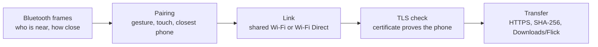

<p align="center">
  
</p>

<h1 align="center">Send a file by bringing two phones together</h1>

<p align="center">
  <a href="https://github.com/DevOps255/Flick/actions/workflows/ci.yml"></a>
  
  
  
  
  
</p>

<p align="center">
  <a href="#how-it-feels">How it feels</a> |
  <a href="#how-it-works">How it works</a> |
  <a href="#build-from-source">Build from source</a> |
  <a href="#project-layout">Project layout</a> |
  <a href="ARCHITECTURE.md">Architecture</a> |
  <a href="GUIDE.md">Installation guide (French)</a>
</p>

Flick is a free and open source app that sends files between phones that are next to each other.
Pick a file, tilt your phone or touch it to the other one, and the transfer starts. Nothing to scan,
nothing to type, no account, no internet, no cloud.

<p align="center">
  
</p>

## How it feels

1. Open Flick on two phones. They find each other over Bluetooth.
2. Choose what to send: documents, downloads, videos, music, apps or photos.
3. Tilt your phone, or hold it against the other one. A glow climbs, gathers at the notch, and a wave
   strikes down the screen, with a vibration that grows with the glow. Both phones play it together.
4. With a file already chosen, the transfer starts by itself as the phones meet. Otherwise, choose a file and bring the phones together again.
   The file travels over a direct, encrypted Wi-Fi link.
5. The other phone saves it in `Downloads/Flick`.

<p align="center">
  
  
  
  
  
</p>

## Highlights

- **One gesture is enough.** Tilt one phone and it pairs with the closest phone. The other phone hears the
  gesture and pairs back, so both start together. Holding two phones top to top pairs them with no gesture.
- **The closest phone wins.** Signal strength is smoothed with a Kalman filter and turned into a distance. When two
  phones are about as close, Flick pairs neither rather than the wrong one.
- **The link is ready before you ask.** The closest phone is linked ahead of time, over the shared Wi-Fi or a
  Wi-Fi Direct group. Both phones agree on the group name and password without talking first.
- **Encrypted and verified.** Every transfer runs over HTTPS. The phone you meant is proven by its certificate,
  and files up to 256 MB carry a SHA-256 that the receiver checks.
- **Several files, several phones.** All the files of a send travel in one session. With the switch on the Nearby screen,
  every ready phone receives them at the same time.
- **A real file browser.** Six categories, fuzzy search that forgives typos, sort by name, date or size, grid and list views,
  thumbnails, installed apps with their icons.
- **Recent files that work.** Open, remove from the list, or delete a received file from the phone.
- **Made to be fast.** The Rust core does the protocol, the sensors maths and the pairing. Kotlin and Compose do the screens.

## How it works



**Finding phones.** Every phone advertises a 21 byte Bluetooth Low Energy frame as manufacturer data and scans for the
same frame from others. The frame holds an 8 byte prefix of the phone's TLS certificate fingerprint, its IPv4
address, its port, a random nonce, and a flag that is up for a couple of seconds after a gesture.

**Measuring closeness.** The signal strength of each frame (RSSI) passes through a one dimensional Kalman filter.
The distance comes from the log distance path loss model, `d = 10 ^ ((-59 - RSSI) / (10 * 2.2))`, where
-59 dBm is the strength at one metre and 2.2 is how fast the signal fades indoors.

**Reading the gesture.** The gyroscope gives the speed at which the phone turns, in radians per second. Adding it
up over the last 600 ms gives the angle turned, `angle = sum(speed * dt)`. A deliberate tilt turns the phone at least 20 degrees,
mostly around one axis, at a speed of at least 0.8 rad/s. Walking and shaking turn the phone back and forth, so their
sum stays near zero and they are ignored. The accelerometer detects a sharp push the same way: gravity is estimated with a low pass
filter and removed, and what is left must cross a threshold and settle within 250 ms.

**Linking the phones.** If both are on one network, nothing is needed. Otherwise they form a Wi-Fi Direct group. The phone with
the larger fingerprint prefix creates it and the other joins. The group name and password are a SHA-256 hash of the two prefixes,
so both compute the same ones with no message exchanged.

**Transferring.** Flick sits on top of the LocalSend protocol. Each phone has a self signed TLS certificate, and the Bluetooth frame
carries the first 8 bytes of its fingerprint. The sender checks that the certificate of the phone it reaches starts with
those bytes, so a recorded or forged announcement is useless. Files stream from an open file descriptor, so a file picked from an SD card
or another app works without a copy.

The full design, with the frame layout, the pairing rules and the sequence of a transfer, is in
[ARCHITECTURE.md](ARCHITECTURE.md).

## Technologies

| Area | What is used |
| --- | --- |
| Core | Rust 1.97.1, Tokio, a vendored LocalSend core (HTTPS server and client, certificates) |
| Bridge | UniFFI 0.28 generates the Kotlin API from Rust, `cargo-ndk` builds `libflick_ffi.so` for every Android processor |
| App | Kotlin 2.0, Jetpack Compose with Material 3, Navigation Compose, Hilt, Room, DataStore, Coroutines and Flow |
| Radio | Bluetooth Low Energy advertising and scanning, Wi-Fi Direct (`WifiP2pManager`), shared Wi-Fi |
| Effects | AGSL runtime shader on Android 13 and later, blur on Android 12 |
| Files | MediaStore, Coil thumbnails with a video decoder, FuzzyWuzzy search |
| Quality | `cargo fmt`, `clippy` with warnings denied, unit tests in Rust and Kotlin, GitHub Actions with an Android emulator |

## Build from source

### What you need

| Tool | Version | Why |
| --- | --- | --- |
| Git | any | to clone the project |
| Rust through [rustup](https://rustup.rs) | 1.97.1, installed for you by `rust-toolchain.toml` | the shared core |
| Android Studio or the command line SDK | platform 35, build tools 35.0.0 | the app |
| Android NDK | 27.0.12077973 | compiles Rust for Android |
| JDK | 17 | Gradle |
| `cargo-ndk` | latest | drives the NDK from Cargo |

### Steps

```bash
# 1. Get the code
git clone https://github.com/DevOps255/Flick.git
cd Flick

# 2. Tell Cargo where the NDK is, then add the three Android targets
export ANDROID_NDK_HOME="$ANDROID_HOME/ndk/27.0.12077973"
rustup target add aarch64-linux-android armv7-linux-androideabi x86_64-linux-android
cargo install cargo-ndk --locked

# 3. Check the Rust code on your computer (optional but quick)
cargo test

# 4. Build libflick_ffi.so for every Android processor
scripts/build-android-libs.sh
```

The script runs `cargo ndk -t arm64-v8a -t armeabi-v7a -t x86_64 -o android/app/src/main/jniLibs build -p flick-ffi --release`.
It writes `libflick_ffi.so` into `android/app/src/main/jniLibs/<abi>/`, where Gradle packages it into the APK.

```bash
# 5. Regenerate the Kotlin bindings after any change to crates/flick-ffi
scripts/generate-kotlin.sh

# 6. Build the app, or install it on a phone with USB debugging
cd android
./gradlew assembleDebug
./gradlew installDebug
```

On Windows use `gradlew.bat` and the same commands in PowerShell or Git Bash.
The step by step guide for phones, with screenshots of the developer settings, is in [GUIDE.md](GUIDE.md).

### A release APK

```bash
cd android
./gradlew clean assembleRelease

# Create a signing key once. Keep the file and the password: you need them for every update.
keytool -genkeypair -v -keystore flick-release.jks -alias flick -keyalg RSA -keysize 4096 -validity 10000

# Align, sign and verify (the tools are in <Android SDK>/build-tools/35.0.0)
zipalign -v -p 4 app/build/outputs/apk/release/app-release-unsigned.apk flick-aligned.apk
apksigner sign --ks flick-release.jks --out Flick.apk flick-aligned.apk
apksigner verify --verbose Flick.apk
```

Do not enable resource shrinking: the screens look their artwork up by name, and the shrinker would remove it.

### Artwork

Drop your PNG files into `android/app/src/main/res/drawable-nodpi/`, with the names listed in
[docs/ICONS.md](docs/ICONS.md). A simple icon is drawn until a file exists.

### Tests

```bash
cargo test                                              # protocol, pairing, gestures, transfers over real TLS
cd third_party/localsend && cargo test -p localsend --features full
cd android && ./gradlew testDebugUnitTest               # file search, sorting, effect timeline
scripts/check-bindings.sh                               # Kotlin bindings match the Rust code
scripts/check-style.sh                                  # house style of the text and comments
```

`.github/workflows/ci.yml` runs all of these on every push, builds the APK with the NDK, starts it on an emulator, and attaches the
APK to the run. A version tag publishes the APK as a release.

## Project layout

```
Flick
├── android/                     Android app (Kotlin, Jetpack Compose)
│   └── app/src/main/java/com/flick/app/
│       ├── core/                Models and interfaces the screens depend on
│       ├── data/                Implementations: transfers, database, file catalog, profile
│       │   └── nearby/          Bluetooth discovery, pairing glue, Wi-Fi Direct link
│       ├── di/                  Hilt modules
│       └── ui/                  Screens: home, send, nearby, transfer, profile, effects, theme
├── crates/
│   ├── flick-proto/             Bluetooth frame, announcement, pairing engine, Kalman filter
│   ├── flick-gesture/           Tilt and flick detectors
│   ├── flick-core/              TLS identity, link planner, send and receive on top of LocalSend
│   ├── flick-ffi/               UniFFI bindings exposed to Kotlin
│   └── flick-acoustic/          Data over ultrasound with ggwave, kept from the first version
├── third_party/                 LocalSend, DashBeam and ggwave, vendored with their licenses
├── tools/ble-probe/             PC tool that prints the Bluetooth signal strength of Flick phones
├── scripts/                     Build, binding generation and check scripts
├── docs/                        Icon guide, PC probe guide, images
├── ARCHITECTURE.md              Design in depth
├── GUIDE.md                     Step by step installation on phones (French)
└── NOTICE.md                    Licenses of the included work
```

## Credits

- [LocalSend](https://github.com/localsend/localsend), Apache 2.0: the transfer protocol and the HTTPS core that Flick builds on.
- [DashBeam](https://github.com/tonyantony300/dashbeam), AGPL 3.0: the design of a fast, direct transfer engine, kept in `third_party/dashbeam`.
- [ggwave](https://github.com/ggerganov/ggwave), MIT: data over sound, used by the `flick-acoustic` crate.

The full list of included code and its licenses is in [NOTICE.md](NOTICE.md).

## License

Flick is released under the [GNU Affero General Public License v3.0](LICENSE).
